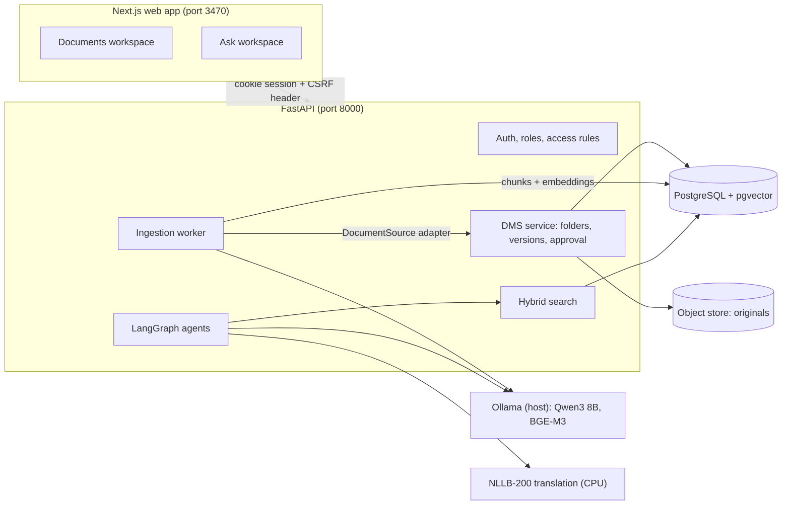
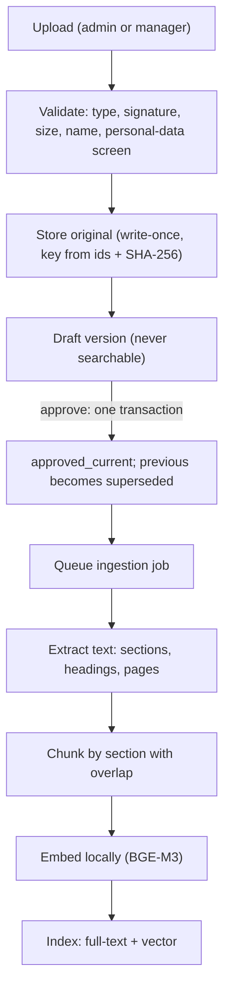
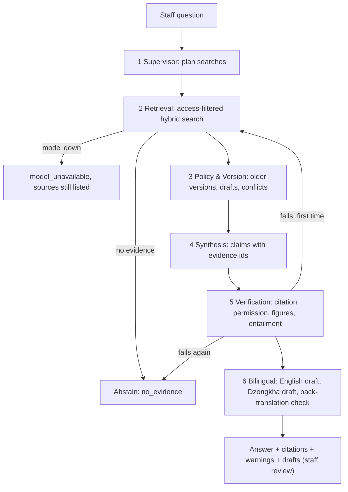

# Architecture

One application, two connected workspaces: a **DMS** (the source of truth for documents) and an **AI knowledge partner** that reads from it. Search indexes are derived data and can be rebuilt at any time.

## Document flow

If embeddings are unavailable the chunks are still stored and the version stays searchable by keyword, with a warning on the job.

## Question flow (six roles)

* The retry loop runs **at most once**; LangGraph's recursion limit is a second guard.
* A conflict skips drafting: the documents must be reconciled by their owners first.
* The LLM never decides access. Retrieval applies the rules inside the query, and the verifier re-checks every cited version.

## Where the boundaries are

| Boundary | Today | Notes |
|----------|-------|-------|
| Documents to knowledge layer | `DocumentSource` interface, `LocalDMSAdapter` | Ingestion reads original files only through the adapter. See [dms-adapter.md](dms-adapter.md) |
| Search backend | PostgreSQL full-text + pgvector | OpenSearch is an optional compose profile and is **not implemented** |
| Chat model | Ollama, local | Never a cloud API |
| Dzongkha | NLLB-200 | Experimental, always human-validated |
